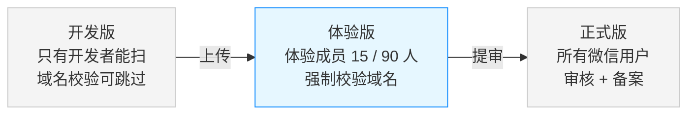

微信开发者工具发布到真机的 开发版   和  WorkBuddy 发布的 体验版   有什么区别？

你问的这两个版本，差别比名字听起来更实质。我先确认几个平台规则的细节，再给你准确的对比。
这两个版本并不是“同一个东西的两个叫法”，差别主要在**谁能打开**、**域名校不校验**、**代码从哪来**。

这几个差异里，**只有一条会真正导致“代码一模一样但结果不一样”，也就是域名校验**——你已经踩到它了。

**1. 代码从哪来**
- **开发版**：开发者工具点「预览」当场打包，生成一张临时二维码；这一步**不进后台版本管理**，且只有开发者本人扫得开。点「上传」才会进后台「开发版本」，每人只保留最新一份。
- **体验版**：必须从**已上传的开发版本**里「选为体验版」，后台只有一份，新上传的会覆盖旧的。
- **WorkBuddy 的「发布」其实就是替你做「上传 + 选为体验版」**。所以它和你手动上传的体验版是同一个东西，在 mp 后台「开发版本」里能看到它。只是省了开发者工具和扫码，产物完全一样。

**2. 域名校验：这是你遇到的真差异**
- 开发版：开发者工具里勾了「不校验合法域名」后，**手机预览、真机调试同样不校验**。
- 体验版、正式版：**强制校验，没有开关**。

所以“开发版能连、体验版连不上”并不是体验版更严格或更危险，而是**体验版已经走在真实用户的链路上**。你那次引擎通、点评断，也正是这条规则在起作用：引擎域名加了白名单，`mp-api` 没加。

**3. 谁能打开**
- 开发版：只有具备开发者权限的项目成员，能给同事测的前提是把他加进开发者。
- 体验版：管理员在后台添加的**体验成员**（个人主体最多 15 人，企业主体 90 人）——这才是“分享给别人看”的正确通道。
- 正式版：所有人搜得到。

顺带纠正一个网上常见的错说法：**体验版没有 7 天有效期**。只要你不换版本，它就一直有效；会过期的是开发版的预览二维码。

**4. 调试能力**
- 开发版：完整 console / vConsole、真机调试、断点，你的「运行日志」和调试面板都在这里能用。
- 体验版：默认没有调试入口（开发者身份有时能手动打开调试，普通体验成员不行）。

排障用开发版，验功能用体验版，这个分工别搞反。

**5. 有一个容易忽略的点：版本之间数据不隔离**

同一 AppID、同一微信用户下，`wx.storage` 是**共享**的；云服务也是**同一套环境**。也就是说：

- 你在开发版里改的设置，体验版打开时还在（`settings.js` 存的偏好会带过去）。
- 更需要注意的是，开发调试时写进云端的测试数据，会直接落在正式数据里。

这对后面阶段三（跨模式画像 / 错题本）是个真实的设计约束：如果要做“测试数据不污染正式库”，就得在写入端自己打标（比如记录一个环境字段），微信和云服务都不会帮你分。

**结论**：你要分享给别人，只能走体验版（加体验成员）或正式版；开发版二维码给不了任何第二个人。现在 AI 通了，建议下一步用体验版把三个模式各走一遍，再决定要不要提审。